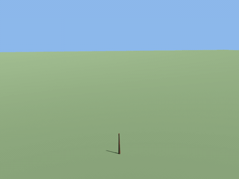
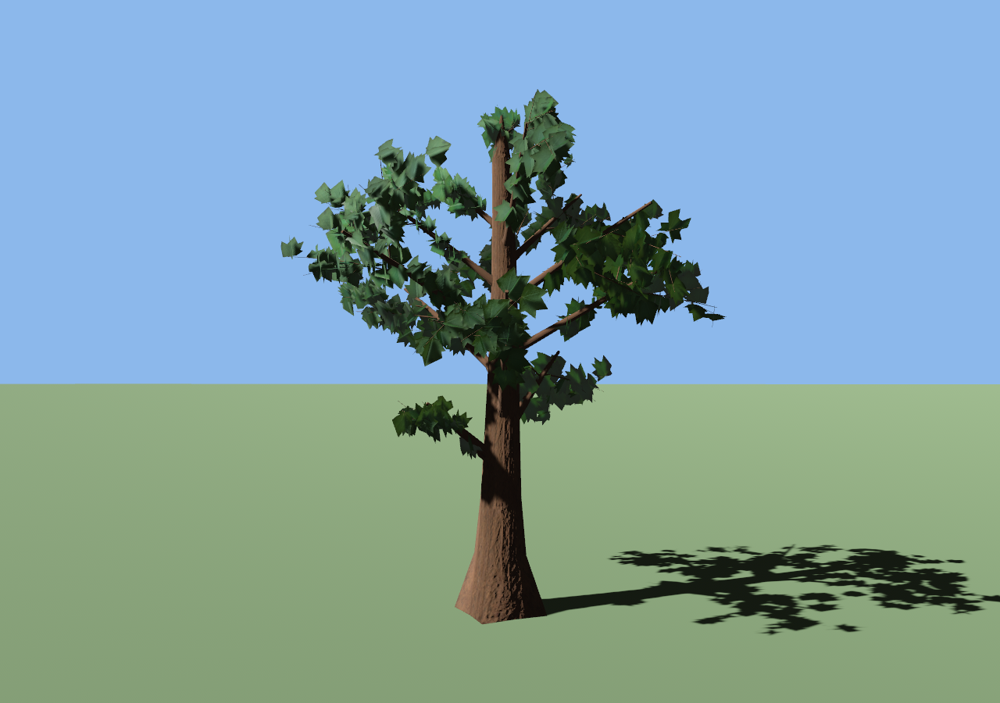

# bevy_flora

> ⚠️ **Vibe Coded.** Written by AI agents working from a human's direction, covered by tests rather than a line-by-line human review. Read the code before you rely on it for something you care about.

**Parametric, stylized procedural trees for Bevy that grow over time**, for anyone building a forest without modelling one: pick one of 20 presets or tune every parameter, spawn a component, and watch a seedling grow into a mature tree. The same seed always gives the same tree.

[](https://crates.io/crates/bevy_flora) [](https://docs.rs/bevy_flora) [](https://github.com/bevy-coven/bevy_flora/actions/workflows/ci.yml) [](https://bevy.org) [](https://github.com/bevy-coven/bevy_flora/blob/main/LICENSE-MIT)



*`cargo run --release --example capture_growth`: the maple preset from age 0 to maturity, in a light wind.*

**Status:** usable · Bevy 0.20 · MSRV 1.97.1

**Why this instead of a hand-modelled or billboard forest:** a tree here is a value, not an asset, so it can be a different tree every run, grow from a seedling while the player watches, and be felled, burnt, picked or scattered by the game at a hundred thousand trees a frame.

## Quick start

```sh
cargo add bevy_flora
```

Add the plugin and spawn a tree. `Growing` advances its age every frame until it is mature; leave it off and set `TreeAge` yourself (the default, `f32::INFINITY`, is the mature tree).

```rust,no_run
use bevy::prelude::*;
use bevy_flora::{FloraPlugin, Growing, ProceduralTree, TreeAge, TreePreset};

fn main() {
    App::new()
        .add_plugins((DefaultPlugins, FloraPlugin))
        .add_systems(Startup, setup)
        .run();
}

fn setup(mut commands: Commands) {
    let mut params = TreePreset::Maple.params();
    params.seed = 7;
    commands.spawn((ProceduralTree(params), TreeAge(0.0), Growing { rate: 1.0 }));
    commands.spawn((
        DirectionalLight { shadow_maps_enabled: true, ..default() },
        Transform::from_xyz(10.0, 20.0, 10.0).looking_at(Vec3::ZERO, Vec3::Y),
    ));
    commands.spawn((Camera3d::default(), Transform::from_xyz(0.0, 5.0, 20.0).looking_at(Vec3::new(0.0, 4.0, 0.0), Vec3::Y)));
}
```

The plugin keeps two child entities on each tree (wood and leaves) and rebuilds their meshes whenever `ProceduralTree` or `TreeAge` changes. It sends a `TreeGenerated` message after each rebuild.

A preset has a name for a command line, an editor or a data file: `"oak".parse::<TreePreset>()` (or `TreePreset::from_name`) is the inverse of `TreePreset::name`, exact and snake_case, and its error lists the presets there are. A tree also says when it is grown, in its own growth units, so a game never has to know that an oak and a palm take different numbers of them:

```rust
use bevy_flora::{TreeAge, TreePreset};

let preset: TreePreset = "dragon_tree".parse().expect("a preset's name");
let params = preset.params();
// Half way through its growing time, whatever the species:
let age = TreeAge(0.5 * params.mature_at());
assert!(age.0 > 0.0 && age.0.is_finite());
```

## Try it

```sh
cargo run --release --example showcase
```

Right-drag and the wheel orbit, `[` `]` cycle the 20 presets, `Space` grows the tree, `X` notches it with an axe and the fourth blow fells it.

## What you can do



*The maple preset at maturity: `cargo run --release --example inspect -- --preset maple --mode tree --distance 15 --yaw 20 --eye 4`.*

- **Grow a tree over any age**, from a seedling to a mature crown, on the CPU or in the vertex shader: [`GpuGrowth`](docs/guide/growing.md#growing-many-trees-gpugrowth) draws 200 growing oaks at 0.81 ms a frame where the CPU rebuild costs 17.6 ms.
- **Build a forest** of a hundred thousand trees from a pool of a few seed variants, with three levels of detail and a baked impostor for the far field: [pools](docs/guide/forests.md#drawing-a-forest-treepool), [looks](docs/guide/forests.md#one-forest-many-looks-poolcolors), [scattering](docs/guide/forests.md#planting-a-forest-scatter) and [terrain](docs/guide/forests.md#on-terrain-floraground).
- **Dress it**: bundled CC0 [bark scans and leaf outlines](docs/guide/appearance.md#leaves-real-outlines-and-grown-veins), [painterly and toon looks](docs/guide/appearance.md#looks-natural-painterly-toon), [low-poly hull conifers](docs/guide/appearance.md#low-poly-conifers-crownstylehull-and-trunkstyleprism), and a year of [seasons, blossom, fruit, snow and rain](docs/guide/seasons.md).
- **Let the game touch it**: [hits and shakes](docs/guide/interaction.md#trees-that-react-treeshakes), [falling leaves](docs/guide/interaction.md#falling-leaves-dropleaves), [picking fruit](docs/guide/interaction.md#picking-fruit-treefruit), [notching and felling](docs/guide/interaction.md#felling-felltree), [fire](docs/guide/interaction.md#fire-florafire), and [bodies pushing through undergrowth](docs/guide/interaction.md#walking-through-undergrowth-foliagepusher).
- **Query the forest**: [capsules for colliders](docs/guide/gameplay.md#gameplay-colliders-growth-events-the-prelude) and a spatial [index](docs/guide/gameplay.md#finding-trees-floraindex) that answers "which tree did I hit" in about 1.6 µs among 100 000, with [sick and dying trees](docs/guide/gameplay.md#finding-trees-floraindex) drawn as such.
- **See the player** through the trunks, and draw an [isometric or top-down camera](docs/guide/camera.md) whose levels of detail follow the zoom rather than the distance.
- **Save and load** what the player did to the forest: [a felled tree, picked fruit and a fire](docs/guide/gameplay.md#saving-and-loading-the-forest).


*`cargo run --release --example forest -- --trees 3000 --scatter oak:3,birch:2,maple:2,pine:1 --grove 60 --clearing 25 --season 1,0 --eye 0,45,-200`, three trees a frame from a pool.*

## Part of the Coven

`bevy_flora` is one crate of [the Bevy Coven](https://github.com/bevy-coven), a family of Bevy plugins for the parts of a game that only scale with human authoring: levels, set dressing, dialogue, villagers' lives, UI and weather. [Grimoire](https://github.com/bevy-coven/bevy_grimoire), the coven's editor, takes this crate as an optional feature and edits a tree's own `TreeParams` live — see [using flora in Grimoire](https://bevy-coven.github.io/crates/bevy_flora.html#use-it-in-grimoire).

## Bevy compatibility

| `bevy_flora` | `bevy` | Rust |
|---|---|---|
| 0.47 | 0.20 | 1.97.1+ (edition 2024) |

## Learn more

- **[docs.rs](https://docs.rs/bevy_flora)** — every type, and what each field costs.
- **[The guide](docs/guide/README.md)** — [growing](docs/guide/growing.md), [forests](docs/guide/forests.md), [appearance](docs/guide/appearance.md), [seasons](docs/guide/seasons.md), [interaction](docs/guide/interaction.md), [cameras](docs/guide/camera.md), [gameplay](docs/guide/gameplay.md), and [the full feature list](docs/guide/features.md).
- **[The gallery](docs/gallery.md)** — every clip and still in this repository, with the command that made it.
- **[The examples](docs/guide/examples.md)** — `showcase`, `gallery` (the visual QA harness), `forest` (the forest benchmark), `inspect`, `capture_growth`, `playground`, `isometric`, `tree_file` and `compare_gallery`.
- **[The book page](https://bevy-coven.github.io/crates/bevy_flora.html)** — the same material on the coven's site.
- **[ARCHITECTURE.md](ARCHITECTURE.md)** — the pipeline and the invariants the meshers rely on.
- **[CHANGELOG.md](CHANGELOG.md)** — what changed, with the measurement behind each change.

## Who and licence

Maintainer [@Ladvien](https://github.com/Ladvien). [Issues](https://github.com/bevy-coven/bevy_flora/issues) and pull requests are welcome; see the coven's [CONTRIBUTING.md](https://github.com/bevy-coven/.github/blob/main/CONTRIBUTING.md).

Licensed under either of [Apache License, Version 2.0](LICENSE-APACHE) or [MIT license](LICENSE-MIT) at your option. Unless you explicitly state otherwise, any contribution intentionally submitted for inclusion in the work by you, as defined in the Apache-2.0 license, shall be dual licensed as above, without any additional terms or conditions.
