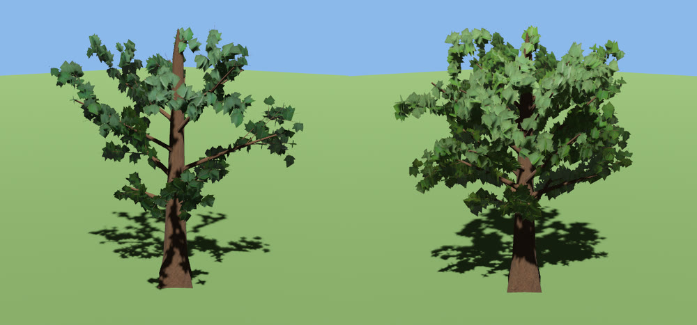
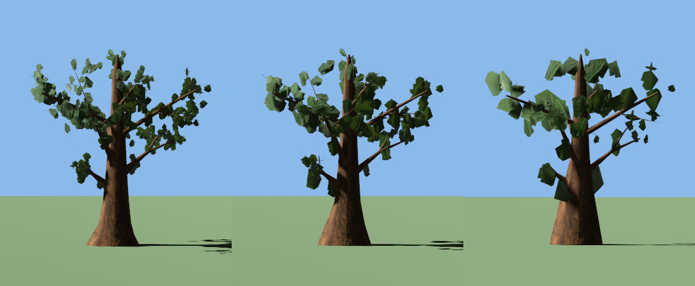
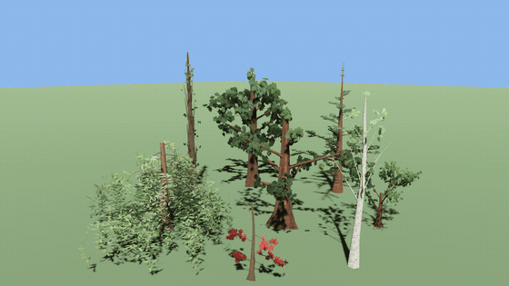
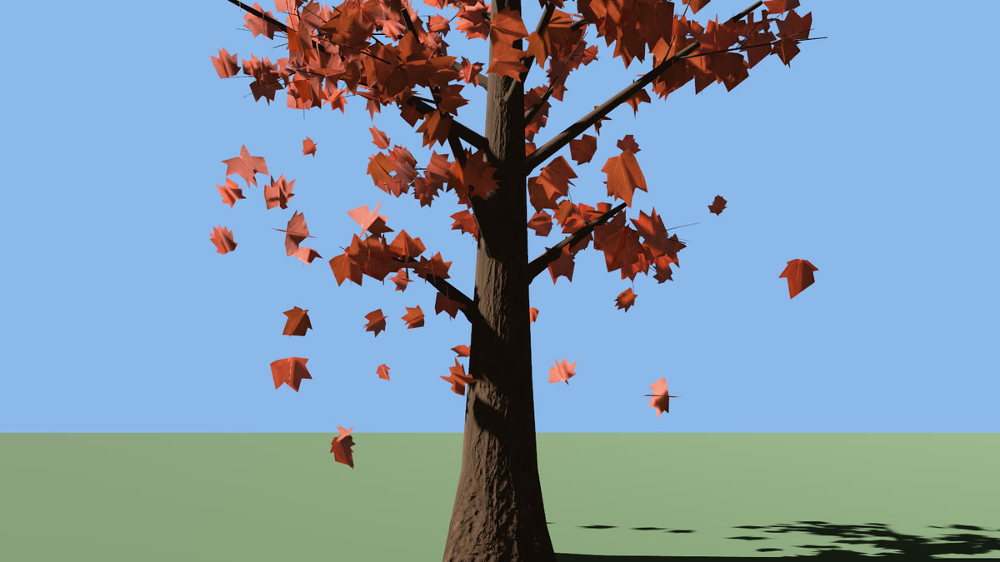
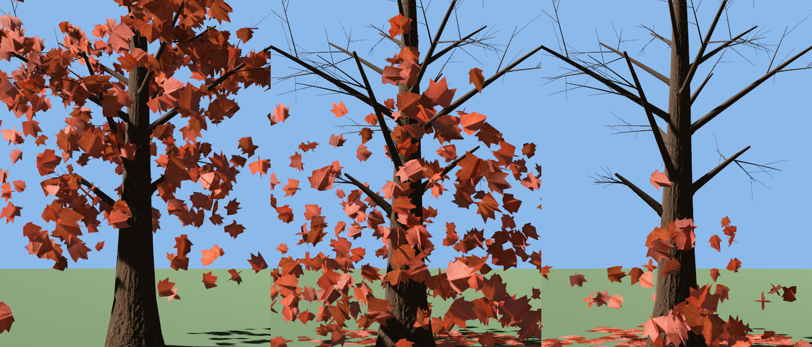
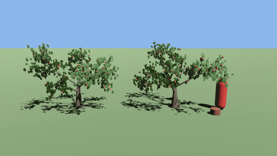
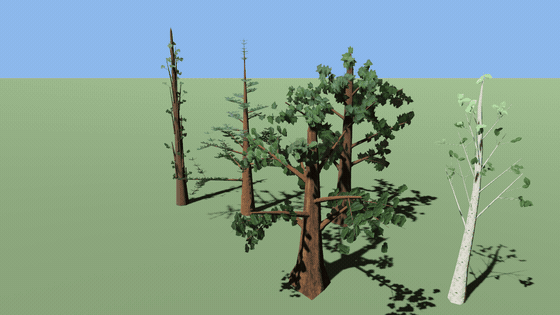
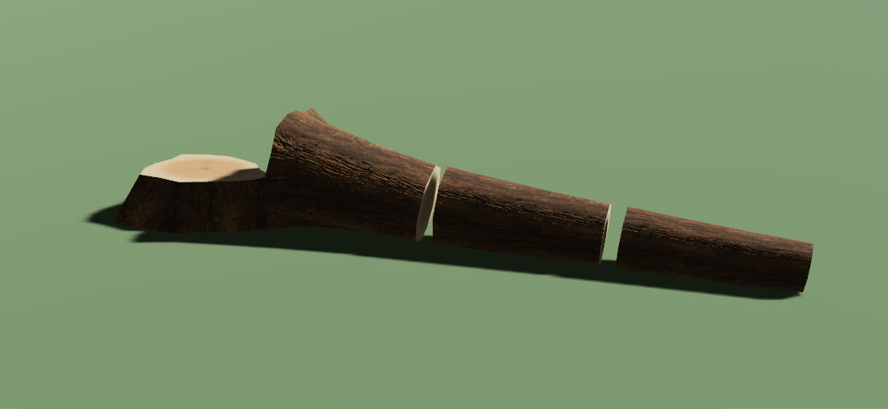
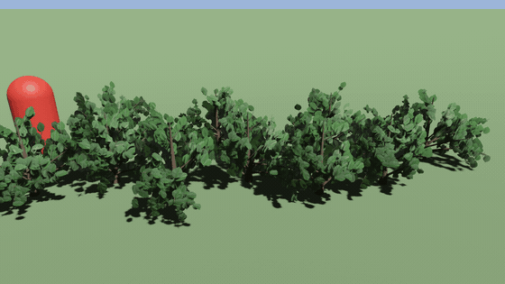
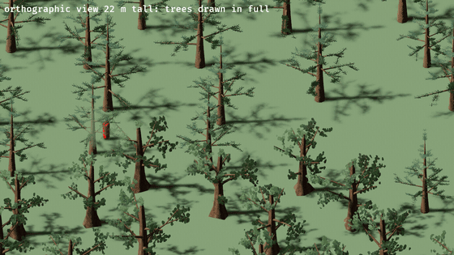

# Gallery

The crate in pictures. Every clip and still here was rendered by an example in `examples/`; the italic
line under each is the command that made it. Each links to the guide page that explains what it shows.

## [Growing a tree over time](guide/growing.md)

## [Forests](guide/forests.md)

## [Seasons and weather](guide/seasons.md)

## [Trees a game touches](guide/interaction.md)

## [Cameras](guide/camera.md)

## [Gameplay queries and saves](guide/gameplay.md)

## [The examples](guide/examples.md)

