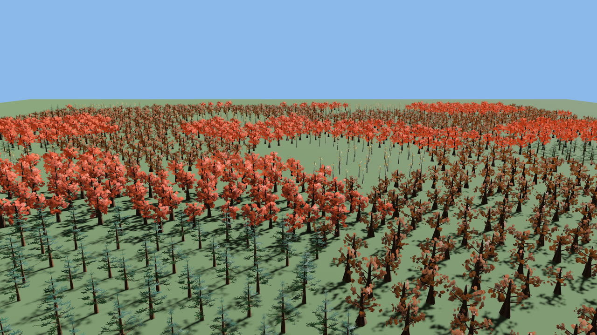
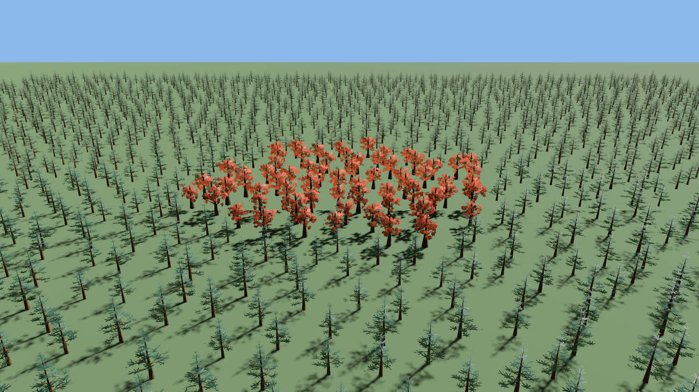
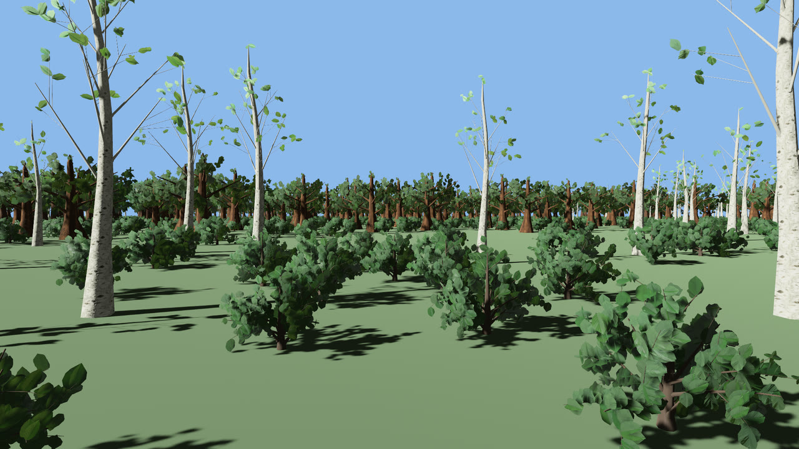
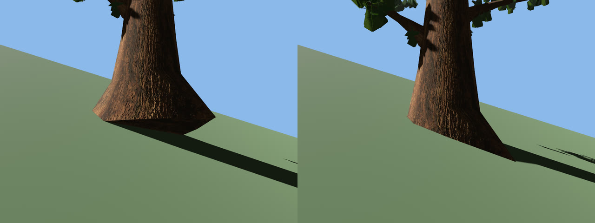
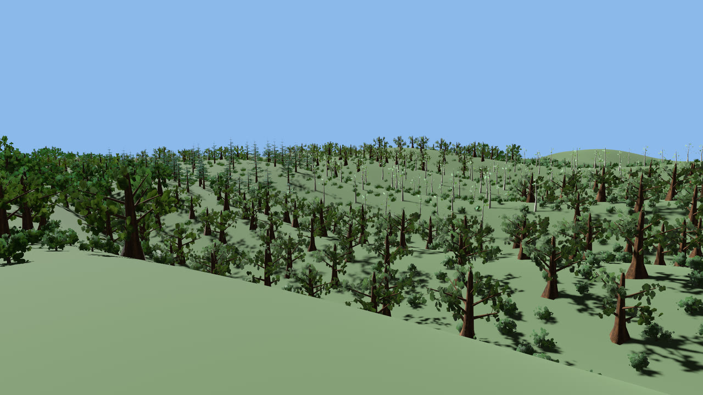

# Forests

From one tree to a hundred thousand: pools, looks, where the trees stand, the ground they stand on and the units they are measured in.

## Drawing a forest: `TreePool`

`ProceduralTree` gives every tree its own meshes, which a GPU can draw a few thousand of. Trees with equal looks (the same colours, trunk height, wind response and leaf shading; seeds and every other parameter may differ) share their two materials, so a thousand oaks cost 22 ms a frame, not 58; give each tree its own colour or trunk height and each gets its own materials again. For a forest build a `TreePool` once, a few seed variants of one tree, and place `PooledTree`s from it. Entities that share a mesh and a material are drawn in one instanced call, and the distance to the camera picks what is drawn: the full tree up close, two coarser levels of detail (30 m and 80 m by default, cross-fading) and, beyond 200 m, one camera-facing quad per tree that shows a view of the variant baked in the running app.

```rust,no_run
use bevy::prelude::*;
use bevy_flora::{FloraPlugin, LodSettings, PooledTree, TreePool, TreePreset, build_pool};

fn forest(
    mut commands: Commands,
    mut pools: ResMut<Assets<TreePool>>,
    mut meshes: ResMut<Assets<Mesh>>,
) {
    let pool = build_pool(
        &TreePreset::Oak.params(),
        8, // variants: seeds 1, 2, ... 8
        f32::INFINITY,
        &LodSettings::default(),
        &mut meshes,
    );
    let pool = pools.add(pool);
    for i in 0..100_000u32 {
        commands.spawn((
            PooledTree { pool: pool.clone(), variant: i },
            Transform::from_xyz((i % 316) as f32 * 8.0, 0.0, (i / 316) as f32 * 8.0),
        ));
    }
}
```

Measured for 0.6.1 with `cargo run --release --example forest -- --offscreen` (1920x1080, one shadow-casting sun, wind on, an oak forest on an 8 m grid seen across it from 30 m up, Apple M4 Pro, release build; the median of three runs on a machine with nothing else running, the runs within 1% of each other; the larger forests are not run with a mesh per tree, which would take an estimated 15 and 75 GB of GPU memory):

| trees | one `ProceduralTree` each | pool, levels of detail only | pool, with impostors |
|---|---|---|---|
| 1 000 | 22 ms | 4.2 ms | 3.3 ms |
| 5 000 | 60 ms | 8.0 ms | 3.3 ms |
| 20 000 | not run | 18.7 ms | 3.4 ms |
| 100 000 | not run | 64.7 ms | 7.3 ms |

Bark (0.7.0) and leaf scans (0.8.0) leave these figures where they were, within what could be measured: the machine these were taken on has been loaded by other builds since, so the table above was not re-measured, and the releases were compared by interleaved runs instead (see the `CHANGELOG`). In those, 100 000 pooled oaks cost no more in 0.8.0 than in 0.7.0 (0.6.2 and 0.7.0 took 7.41 and 7.45 ms), and a thousand individual `ProceduralTree` oaks cost 4 to 10% more, because a leaf card cut to a real outline has more vertices than the old fan. The looks of 0.9.0 do not move them: the natural look draws the same pixels as 0.8.0 with the same shaders, and in interleaved runs 100 000 pooled oaks took 12 to 16 ms in all three looks on a machine under load, a thousand individual ones 31 to 48. Seasons (0.11.0) add under 1%: 100 000 pooled oaks took 7.33 ms in 0.10.0 and 7.40 in 0.11.0, a thousand individual oaks 23.4 and 23.6 ms (medians of three interleaved runs on a quiet machine), and half-bare trees are cheaper (22.1 ms).

The pool's trees are static: they have the age the pool was built at, and growing trees stay `ProceduralTree` (with `GpuGrowth`), which suits the few that are close. Impostors are baked once per variant by a few frames of offscreen rendering, so a tree appears when that is done (100 000 pooled oaks are all in about 2 s after they are placed, at most 4096 trees getting their children a frame; 0.38.1, Apple M4 Pro), and they need `FloraPlugin` added after `DefaultPlugins` (before it, with no renderer, or on a device without storage buffers in the vertex stage such as WebGL2, the coarsest level is drawn at every distance and one warning says so). They are baked unlit, as a neutral grey colour picture (a pool's looks tint it, below) and a surface picture, and shaded by the scene's own lights every frame: they follow the time of day, glow with the sun behind them and sway with the wind. They show one of eight views, all taken from one height above the horizon (`LodSettings::impostor_elevation`, 10° by default), and cast no shadows unless the pool asks (`LodSettings::impostor_shadows`; see the orthographic cameras below). With MSAA an impostor keeps the gaps of its crown: each pixel draws the share of its samples the baked tree covers, so a far crown is as airy, and as light, as the leaves it stands for. Level 2 and the impostors replace thin twigs and most leaves, so a forest seen from above or close up should keep its near trees at level 0.

Shadows are a large part of a forest's cost: every shadow cascade draws every tree that casts into it. Put `NotShadowCaster` on a `PooledTree` (or a `ProceduralTree`) and none of what draws it casts; take it off and it casts again. `FloraShadows { radius }` does that for the whole forest around the camera: the standing trees farther than `radius` metres (times `FloraUnits`, like the levels' distances) from the main camera's place on the ground (under a perspective camera; where an orthographic one looks) cast no shadow, and it follows the camera as it moves, touching only the trees that cross the edge. A tree the game quiets itself is left alone, and removing the resource gives the others their shadows back. `forest --shadow-radius 150` lets only the trees within 150 m of the camera cast: 1 000 individual oaks take 20.3 ms a frame instead of 24.6, 100 000 pooled oaks 7.2-7.3 ms instead of 7.5 (0.35.0, Apple M4 Pro, `--offscreen --deterministic`, marking the trees once as they were placed).

## Building pools without a stall: `BackgroundPools`

`build_pool` builds a pool's variants on all cores, and the frame that calls it waits. On an Apple M4 Pro an eight-variant pool takes from 0.5 ms (the dead tree) to 14 ms (the apple tree), and the eighteen presets' pools 116 ms in all; one variant alone takes 0.1 to 8.7 ms, so a machine with fewer cores waits longer, and wasm, which builds the variants one after the other, about 0.3 s for all of them. `BackgroundPools` builds them on Bevy's async compute pool instead: `build` hands back the pool's handle at once, and the plugin adds the pool when it is built, a few frames later. Trees placed from the handle meanwhile appear then, as trees placed from any pool not yet added do, so a game builds its pools and places its forest in one system, at load or as the player walks into a new biome, and its frames go on.

```rust,no_run
use bevy::prelude::*;
use bevy_flora::prelude::*;

fn forest(mut commands: Commands, mut pools: BackgroundPools) {
    let lod = LodSettings::default();
    let oak = pools.build(&TreePreset::Oak.params(), 8, f32::INFINITY, &lod);
    let pine = pools.build(&TreePreset::Pine.params(), 8, f32::INFINITY, &lod);
    for i in 0..10_000u32 {
        let pool = if i % 3 == 0 { pine.clone() } else { oak.clone() };
        let at = Vec3::new((i % 100) as f32 * 8.0, 0.0, (i / 100) as f32 * 8.0);
        commands.spawn((PooledTree { pool, variant: i }, Transform::from_translation(at)));
    }
}
```

The pool is the one `build_pool` makes from the same arguments, mesh for mesh, and `BackgroundPools::pending` counts the pools still building (for a loading screen); dropping every handle to a pool still building cancels it. `BackgroundPools` holds no `Assets<TreePool>`, so a system can take it next to a `ResMut<Assets<TreePool>>`. Once its pools are in, a forest costs the same per frame however they were built. `forest --background-pools` and the `isometric` example build their pools this way.

## One forest, many looks: `PoolColors`

A pool can be drawn in more than one colouring without a second set of meshes. `TreePool::looks` starts with look 0, the colours of the parameters; `add_look` adds more (before the pool goes into the assets), and a `PooledTree` picks one with `PooledLook(n)`. Three looks of one forest draw the same meshes with three pairs of materials, impostors included: they are baked neutral grey and take a look's colours as a tint. Pools whose looks are equal share their materials: the ages of one species, or two looks of one wood colour, draw with the same ones, so a forest of four species at three ages in three looks draws with at most 24 materials instead of 72 (`forest --ages 3 --looks`: 4.55 ms a frame instead of 5.49 for 20 000 trees, Apple M4 Pro). A look can be `unlit`: its wood, leaves, impostors and cut faces then show their colour as it is, with no lighting, shadows or light through the leaves (the rain, the snow and the fire still mark it), for a map, a diagram or a dream. `RecolorPool` changes a look's colours at runtime, every tree in it at once, and only that pool's: the pool asset is never touched and no mesh is rebuilt. When every pool that shares a material is recoloured alike in one frame (a palette that glides through the day over a species' pools) the material is written in place, a few material writes a frame; a pool recoloured on its own takes materials of its own, and its trees are pointed at them, until it is recoloured like the others again. Scans keep their pattern and the autumn and blossom colours follow the new leaf colour. A pooled tree that is felled or notched keeps its look (`TreePool::tree_params_for`) and goes on following it: it, its stump and its logs carry `FromPool { pool, look }`, and every `RecolorPool` of that look recolours them with the standing trees (remove `FromPool` to keep one as it is; `RecolorTree` recolours any of them on its own).

```rust,no_run
use bevy::prelude::*;
use bevy_flora::prelude::*;

fn looks(
    mut commands: Commands,
    mut pools: ResMut<Assets<TreePool>>,
    mut meshes: ResMut<Assets<Mesh>>,
) -> Handle<TreePool> {
    let mut pool = build_pool(&TreePreset::Oak.params(), 8, f32::INFINITY, &LodSettings::default(), &mut meshes);
    // Look 0 is the oak's own colours; the others are added before the pool goes into the assets.
    let dusk = pool.add_look(PoolColors { wood: Color::srgb(0.20, 0.10, 0.10), leaves: Color::srgb(0.40, 0.15, 0.30), unlit: false });
    let map = pool.add_look(PoolColors { wood: Color::BLACK, leaves: Color::srgb(0.10, 0.80, 0.40), unlit: true });
    let pool = pools.add(pool);
    commands.spawn((PooledTree { pool: pool.clone(), variant: 3 }, PooledLook(dusk)));
    commands.spawn((PooledTree { pool: pool.clone(), variant: 4 }, PooledLook(map)));
    pool
}

// Later: dawn, over half a minute. Every tree in look 1 follows, and so does every impostor of it.
fn dawn(pool: &Handle<TreePool>, mut recolor: MessageWriter<RecolorPool>) {
    let colors = PoolColors { wood: Color::srgb(0.35, 0.22, 0.12), leaves: Color::srgb(0.55, 0.60, 0.25), unlit: false };
    recolor.write(RecolorPool { pool: pool.id(), look: 1, colors, glide: 30.0 });
}
```

`glide` is how many seconds the look takes to get there, blended in linear RGB from the colours it shows, so a day's palette can fade instead of snap. The glide is drawn on the GPU: every mesh of a pooled tree, its impostor and the pool's deadfall carries its look's `MeshTag`, and while the look glides the shaders multiply its colours by the frame's blend, which the plugin writes into the shared buffer the wind already lives in. No material is written until the glide arrives; then the look's materials take the new colours once, as a recolour at once does (Bevy re-prepares every mesh drawn with a material that changes, so writing them every frame would cost the CPU 60 ms a frame for 20 000 trees; the glide costs it nothing to see). Turned leaves keep the species' autumn colour and flowers their blossom, an unlit look turns lit or unlit as it arrives, and the trees felled from the look follow it frame by frame. Up to `RecolorPool::MAX_GLIDE_LOOKS` (64) looks of all pools glide this way; past that, or on a device without flora materials, a look glides by being recoloured at once every frame. A glide of 0 changes it at once; a later recolour of the look takes over from wherever it is. `forest --looks` draws a forest in three looks side by side (the oak's own, a lit autumn one, a flat unlit one), and `--looks --recolor` recolours two of them after the warmup (`--glide <s>` over `s` seconds).

## Planting a forest: `Scatter`

A grid of trees reads as an orchard. `Scatter` spreads them the way a forest stands: trunks never closer than `spacing` and otherwise irregular (Poisson-disc sampling, Bridson 2007), species in groves about `grove_size` wide whose borders bend instead of salt and pepper, and every tree its own yaw, size (`scale`, 0.85 to 1.15 by default) and pool variant. `points_where` takes a density for each spot, 0 for a road, a lake or a village and a fraction for open woodland, and only ever removes trees, so carving a clearing never moves the trees around it. It is pure CPU and deterministic per seed: 90 000 trees in groves take 0.2 s (Apple M4 Pro), once.

```rust,no_run
use bevy::prelude::*;
use bevy_flora::prelude::*;

fn plant_forest(mut commands: Commands, mut meshes: ResMut<Assets<Mesh>>, mut pools: ResMut<Assets<TreePool>>) {
    let lod = LodSettings::default();
    let species: Vec<Handle<TreePool>> = [TreePreset::Oak, TreePreset::Birch, TreePreset::Pine]
        .iter()
        .map(|preset| pools.add(build_pool(&preset.params(), 8, f32::INFINITY, &lod, &mut meshes)))
        .collect();
    let forest = Scatter {
        species: vec![3.0, 2.0, 1.0], // three oaks to two birches to one pine
        grove_size: 60.0,
        ..Scatter::new(Rect::new(-500.0, -500.0, 500.0, 500.0), 7.0)
    };
    // A road along the x axis, kept clear.
    for tree in forest.points_where(|at| if at.y.abs() < 6.0 { 0.0 } else { 1.0 }) {
        commands.spawn((
            PooledTree { pool: species[tree.species].clone(), variant: tree.variant },
            tree.transform(0.0), // on terrain: `tree.transform_on(&ground, &params)`, below
        ));
    }
}
```

`forest --scatter oak:3,birch:2,maple:2,pine:1 --grove 60 --clearing 25` plants one, here in autumn so the groves show:



*`cargo run --release --example forest -- --trees 3000 --spacing 7 --scatter oak:3,birch:2,maple:2,pine:1 --grove 60 --clearing 25 --season 1,0 --eye 0,45,-200 --at 0,0,-20 --wind 0 --deterministic --screenshot scatter.png`*

`points_with` also weighs each species at each spot, for stands the game places: snags in a dead patch, saplings along the forest's edge, old giants deep inside. Its second closure, `weight(at, species)`, multiplies a species' share where a tree stands: 0 shuts the species out there, and where every weight is 1 the forest is `points_where`'s, tree for tree. Inside a stand of two species their groves still meet along bent borders, and a weight that fades out over a rim bends the stand's edge with the groves:

```rust,no_run
use bevy::prelude::*;
use bevy_flora::prelude::*;

// The last species alone within 35 m of `centre`, fading out over the next 20 m, and nowhere else.
fn with_a_stand(forest: &Scatter, centre: Vec2) -> Vec<ScatterPoint> {
    let last = forest.species.len() - 1;
    forest.points_with(
        |_| 1.0,
        |at, species| {
            let out = ((at.distance(centre) - 35.0) / 20.0).clamp(0.0, 1.0);
            if species == last { 1.0 - out } else { out }
        },
    )
}
```



*`cargo run --release --example forest -- --trees 3000 --scatter pine:1,maple:1 --grove 30 --stand 0,0,45 --season 0.8,0 --eye 0,60,-150 --at 0,0,0 --wind 0 --deterministic --screenshot stand.png`*

Undergrowth is a second, closer scatter that keeps clear of the trunks, drawn from the `Shrub` preset (a mound of arching stems about 1.4 m high and 1.9 m across: 5 900 wood and 17 600 leaf triangles up close, 2 100 in all at its coarsest level):

```rust,no_run
use bevy::prelude::*;
use bevy_flora::prelude::*;

// Shrubs at least 2.5 m apart and 1.5 m from every trunk. For a big forest, look the trunks up in a
// grid instead of all of them (the `forest` example does).
fn plant_undergrowth(commands: &mut Commands, trees: &[ScatterPoint], area: Rect, shrubs: &Handle<TreePool>) {
    let layer = Scatter { seed: 2, ..Scatter::new(area, 2.5) };
    for shrub in layer.points_where(|at| if trees.iter().any(|t| t.position.distance(at) < 1.5) { 0.0 } else { 1.0 }) {
        commands.spawn((PooledTree { pool: shrubs.clone(), variant: shrub.variant }, shrub.transform(0.0)));
    }
}
```



*`cargo run --release --example forest -- --trees 1500 --spacing 7 --scatter oak:3,birch:2,maple:2 --grove 30 --clearing 14 --undergrowth shrub:2.5 --eye -14,1.8,-30 --at 6,1,0 --fov 55 --sun 20,25,-30 --wind 0 --deterministic --screenshot undergrowth.png`: the example's undergrowth also thins out in patches about 30 m across.*

A shrub stands about a tenth as tall as a tree, so its pool can hand over to coarser levels much nearer: build it with half the default distances, `LodSettings { distances: LodDistances { lod1: 15.0, lod2: 40.0, impostor: 100.0 }, ..default() }`, as the example does. In the forest above (1 372 trees and 4 863 shrubs, `--offscreen --deterministic`, the default camera), the trees alone take 2.7 ms a frame; with the shrubs at the trees' distances 7.9 ms, at half of them 3.3 ms (Apple M4 Pro).

## On terrain: `FloraGround`

A tree stood at the ground's height under its centre floats on a slope: the downhill side of its trunk hangs in the air over the ground, its flat base showing. `FloraGround` is the height of your ground at every point (x, z), your terrain's height function or a lookup into its heightmap, and `footing(at, radius)` is the lowest ground under a trunk's base, where a tree stands so that its trunk meets the ground all round. `TreeParams::base_radius()` is that base, flare and root ridges included, and `ScatterPoint::transform_on(&ground, &params)` does it for a scattered tree at its own scale. `slope(at)` and `normal(at)` keep trees off cliffs and screes.

```rust,no_run
use bevy::prelude::*;
use bevy_flora::prelude::*;

fn height(at: Vec2) -> f32 {
    6.0 * (at.x * 0.03).sin() * (at.y * 0.02).cos() // your terrain, or a heightmap lookup
}

fn plant_on_hills(mut commands: Commands, mut meshes: ResMut<Assets<Mesh>>, mut pools: ResMut<Assets<TreePool>>) {
    let ground = FloraGround::new(height);
    let oak = TreePreset::Oak.params();
    let pool = pools.add(build_pool(&oak, 8, f32::INFINITY, &LodSettings::default(), &mut meshes));
    let forest = Scatter::new(Rect::new(-200.0, -200.0, 200.0, 200.0), 8.0);
    // Nothing on ground steeper than 30°.
    for tree in forest.points_where(|at| if ground.slope(at) > 30f32.to_radians() { 0.0 } else { 1.0 }) {
        commands.spawn((PooledTree { pool: pool.clone(), variant: tree.variant }, tree.transform_on(&ground, &oak)));
    }
    // Felled trees are cut above the uphill side of their trunk and land on the hills.
    commands.insert_resource(ground);
}
```



*`cargo run --release --example inspect -- --out target/footing --preset oak --mode tree --slope 25 --distance 4 --eye 0.6 --look 0.04` (right), with `--on-centre` (left).*

As a resource it is also the ground felling uses: the saw goes in `cut_height` above the trunk's uphill side, so a stump on a slope is taller on its downhill side, and a felled tree comes to rest where its trunk or limbs meet the terrain, turning further than on flat ground when it falls down the slope and less when it falls against it. Without it the ground is flat at each tree's own height, as before. The crate does not draw the ground: `FloraGround` is only what trees stand and fall on, so it must match the terrain you draw. Branches and leaves are not bent to the slope: on steep ground a spruce's lowest whorls and a willow's strands on the uphill side run into the hillside.



*`cargo run --release --example forest -- --trees 3000 --spacing 7 --scatter oak:3,birch:2,pine:2,maple:1 --grove 50 --clearing 30 --terrain 14 --undergrowth shrub:3 --eye 0,2,0 --at -80,8,0 --fov 50 --wind 0.3 --deterministic --screenshot terrain.png`: `--terrain 14` draws hills about 14 m high and plants every tree and shrub at its footing, none on ground steeper than 30°.*

## A world that is not in metres: `FloraUnits`

The crate builds trees in metres, and a game scales them to its world with a `Transform`. A world whose unit is a foot, say, scales its trees by about 3.28, and everything the crate then measures in the world itself has to follow: how fast a tree falls (gravity is 9.81 m/s²), how far a falling leaf drifts, how wide a gust is, how far a fire reaches, how big a pusher is, how far away the levels of detail change. Insert `FloraUnits` with the number of world units to a metre and all of it does:

```rust,no_run
use bevy::prelude::*;
use bevy_flora::prelude::*;

fn setup(mut commands: Commands) {
    // A world in feet: trees are placed with `Transform::from_scale(Vec3::splat(3.2808))`.
    commands.insert_resource(FloraUnits { units_per_metre: 3.2808 });
}
```

The rule, written on every field it touches: a field that sizes or times the crate's own simulation is in **metres** and is multiplied by `units_per_metre` where it meets the world (`FellTree::cut_height`, `TreeNotch::height`, `BuckTree`, `FireSpread::speed` and `reach`, `FoliagePusher::radius` and `height`, `SeeThroughTrees::radius`, `TreeShake::radius`, `GustFront::speed` and `width`, `LodDistances`, `FloraShadows::radius`, `FallingLeaves::autumn_distance`); a position, or a size that addresses the world, is in **world units** (every `at`, `target`, `centre` and `origin`; the size of `FloraFire` and the radius of `ignite`, `extinguish` and `scorch`; `FloraIndex`'s radii and distances; `Scatter`'s area and spacing; `FloraGround`'s heights). The default, 1.0, is a world in metres and changes nothing. Set it before planting: a pooled tree's bands of distance are made when it is spawned. A felled oak lands on the same update in a world in feet as in metres, a fire spreads the same number of cells a second and the default pusher covers the same share of a shrub (tests in `felling.rs`, `fire.rs` and `push.rs`).

## Deadfall: `PooledDeadfall`

A forest floor has stumps, fallen trees and logs. `build_pool_with_deadfall` builds a pool that also holds each variant cut as `FellTree` and `BuckTree` would cut it, and a `PooledDeadfall` places one for the cost of a pooled tree: a `Stump` (its wood and cut face, a `TreeStump` with no tree), a tree `Lying` where it fell (turned about the cut's hinge until its limbs reach the ground, `FloraGround` included, in the look's calm wood and leaves) or `Bucked` (the stump and `TreeLog`s in a row from it). It takes `PooledLook`, `NotShadowCaster`, `RecolorPool` and `RecolorTree`, burns, and is never in the `FloraIndex`; `BuckTree` on a lying one bucks it in place.

```rust,no_run
use bevy::prelude::*;
use bevy_flora::{DeadfallKind, DeadfallSettings, LodSettings, PooledDeadfall, TreePool, TreePreset, build_pool_with_deadfall};

fn forest_floor(mut commands: Commands, mut pools: ResMut<Assets<TreePool>>, mut meshes: ResMut<Assets<Mesh>>) {
    let pool = build_pool_with_deadfall(
        &TreePreset::Spruce.params(),
        4,
        f32::INFINITY,
        &LodSettings::default(),
        &DeadfallSettings::default(),
        &mut meshes,
    );
    let pool = pools.add(pool);
    let kind = DeadfallKind::Lying { direction: Vec2::X };
    commands.spawn((PooledDeadfall { pool, variant: 0, kind }, Transform::from_xyz(10.0, 0.0, 4.0)));
}
```

A standing pooled tree becomes deadfall in place with `IntoDeadfall(kind)`: the same entity, now a `PooledDeadfall` of its own pool, variant and look, where it stood, its shadow opt-out kept. That is what a save restores for the trees felled before it. `ScatterPoint::id` names a scattered tree (the same for a seed, area and spacing, whatever a density or a stand keeps), so the save can keep the ids of the felled trees and the load plant those as stumps, matching no positions:

```rust,no_run
use bevy::prelude::*;
use bevy_flora::{DeadfallKind, IntoDeadfall, PooledTree, Scatter, TreePool};

fn plant(mut commands: Commands, forest: &Scatter, pool: Handle<TreePool>, felled: &[u32]) {
    for tree in forest.points() {
        let mut planted = commands.spawn((PooledTree { pool: pool.clone(), variant: tree.variant }, tree.transform(0.0)));
        if felled.contains(&tree.id) {
            planted.insert(IntoDeadfall(DeadfallKind::Stump));
        }
    }
}
```
