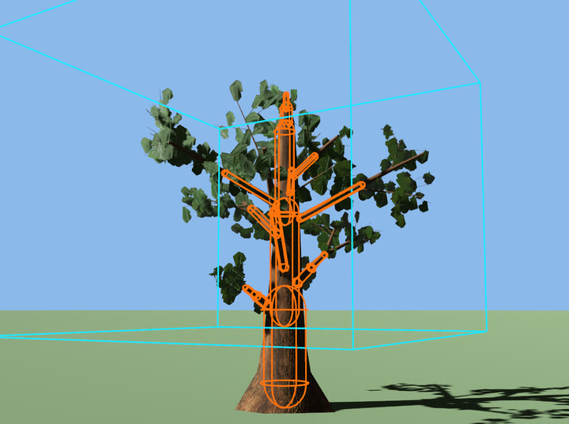

# Gameplay queries and saves

A tree's shape as colliders, finding the tree you mean among a hundred thousand, and putting the forest back as the player left it.

## Gameplay: colliders, growth events, the prelude

A game wants a tree's shape in a handful of primitives, not twenty thousand triangles. Insert `TreeShape::default()` next to a `ProceduralTree` (or a `PooledTree`) and the plugin keeps it up to date: three capsules up the trunk that taper with it (the lowest has the trunk's radius at hip height, so a walking character meets what it sees), one capsule for every stretch of wood at least `limb_radius` thick (6 cm by default; `TreeShape::with_limb_radius`), and a box around the leaves, all in the tree's local space. A growing tree's shape grows with it on both the CPU and the `GpuGrowth` path, and it is written only when it changes, so `Changed<TreeShape>` is the cue to rebuild colliders. `WoodCapsule::to_primitive` gives Bevy's `Capsule3d` and where it sits, which is what most physics engines' capsule colliders take. Building the shape costs about as much as ageing the skeleton (6 to 9 microseconds a tree on an Apple M4 Pro), which is why it is opt-in. `TreeMature` is sent once when a `Growing` tree reaches maturity, and `use bevy_flora::prelude::*;` brings in the plugin, the components, the presets and parameters, the wind and the shapes.

```rust,no_run
use bevy::prelude::*;
use bevy_flora::prelude::*;

fn plant(mut commands: Commands) {
    commands.spawn((
        ProceduralTree(TreePreset::Oak.params()),
        TreeAge(0.0),
        Growing::default(),
        TreeShape::default(), // kept up to date while the oak grows
    ));
}

// Hand the capsules to your physics engine whenever the shape changes.
fn colliders(trees: Query<(Entity, &TreeShape), Changed<TreeShape>>) {
    for (tree, shape) in &trees {
        for capsule in shape.capsules() {
            let (capsule, place) = capsule.to_primitive(); // Capsule3d along the wood
            info!("{tree}: a capsule of radius {:.2} m at {:?}", capsule.radius, place.translation);
        }
    }
}

fn on_mature(mut mature: MessageReader<TreeMature>, mut commands: Commands) {
    for message in mature.read() {
        commands.entity(message.entity).remove::<Growing>();
    }
}
```

`examples/showcase.rs` draws the shape over the tree (`C`), and `inspect --colliders` photographs it:



*`cargo run --release --example inspect -- --out target/shape --preset oak --mode tree --colliders --distance 13 --eye 2 --look 0.45 --yaw 30`*

## Finding trees: `FloraIndex`

Which tree did the axe hit, which one is nearest the woodcutter, which ones stand in the blast? The plugin keeps a `FloraIndex` resource of every standing tree, `ProceduralTree` and `PooledTree` alike (a pooled one once its pool exists), each as its trunk: a cone from its foot to its top, at the age it shows and where it stands after transform propagation. A tree moved, rebuilt or grown is updated that frame, and a felled or despawned one leaves it. It is a grid of 8 m cells, so a query costs the trees near it, not all of them: with 100 000 pooled oaks, `nearest` takes about 1.6 µs and `cast_ray` over 50 m about 0.6 µs.

- `nearest(at, max)`: the tree whose bark at the foot is nearest a point (world x and z), within `max` metres (`f32::INFINITY`: wherever it is, which looks at every tree); of two as near, the first in `within`'s order.
- `within(at, radius)`: every tree whose bark at the foot is within `radius` metres, in an order set only by where the trees stand (cell by cell, by position within a cell), so a replay or a world streamed in another order sees the same answers.
- `cast_ray(ray, max)`: the first trunk a ray meets, as `TreeHit { tree, point, normal, distance }`: the player's look, an arrow, a falling branch (`max` may be `f32::INFINITY`: the walk stops where the ray leaves the cells the trees fill). Crowns and leaves do not stop it.
- `get(entity)`, `iter()`, `len()`: each tree as an `IndexedTree { entity, base, axis, height, base_radius, top_radius, undergrowth, condition }`. `undergrowth` is the plant's `TreeParams::undergrowth` (the shrub, juniper and fern presets): filter on it where only trees count, an axe's or a wall's. `condition` is the tree's `TreeCondition`, below.
- `condition_of(entity)`: how well a tree is, `Some(TreeCondition)` for a tree the index holds and `None` for one it does not (a felled tree, a despawned one, a pooled tree whose pool has not loaded).
- `obstacles_within(at, radius)`, `obstacles()`: the lying wood a walker bumps into, which the queries above (standing trees) do not hold: every stump (felled or pooled, its `TreeStump::capsule` from its foot to its cut), bucked log (`TreeLog::capsule`) and the trunk and limbs above the cut of a tree lying on the ground (a felled tree at rest that has a `TreeShape`, and a pooled deadfall's lying tree), as `Obstacle { entity, kind, capsule }` in world space; `Obstacle::distance_to(at)` measures across the ground. A falling tree joins once it lies still, and anything goes with its entity.

**Sick and dying trees.** A tree has a `TreeCondition`, `Healthy`, `Sick` or `Dying` (ordered, so `condition >= TreeCondition::Sick` is "not healthy"), a component on the tree's own entity that a game sets by inserting it: `commands.entity(tree).insert(TreeCondition::Sick)`. A tree with none is healthy, so a forest of a hundred thousand pays nothing for the trees that are well, and inserting `Healthy` or removing the component clears it. The index shows a change from the next frame, on every tree a query returns. The condition is the *tree's*, not its pool's: a pooled tree keeps it through a change of variant, a reload of its pool and being taken off its pool and put back, and one set before its pool has loaded shows when it does; a felled tree leaves the index and keeps the component as it was when it was cut.

The tree is drawn in its condition. A `Sick` crown has lost about a third of its leaves (`TreeCondition::defoliation`, 0.35) and the leaves that are left have withered half way to a dry ochre-brown (`TreeCondition::withering`), each its own way, so the crown is thin and mottled; a `Dying` one has lost four fifths and what is left is dry. The wood, the fruit and the flowers are as they were, and the leaves are lost in the shadow maps too, so a thin crown lets the light through. Every level of detail, the impostors and trees that grow on the GPU show the same condition, a leaf a shake or the season knocks off a sick tree is one it still has (and falls as dry as those on it), and it composes with `FloraSeason` and `RecolorTree`. The class travels in the `MeshTag` of the tree's meshes, above a pooled look's glide tag, so trees of one mesh and material still draw in one batch whatever their conditions; a device without flora materials (no vertex-stage storage buffers, WebGL2) shows the state and not the look. `inspect --condition sick|dying` and `forest --sick <share> --dying <share>` show it, and the gallery has 30 `condition_*` scenarios.

**A change of condition can glide.** By default a class is drawn the frame after it is set: a sick oak has lost a third of its leaves at once. `ConditionGlide { seconds }` (a resource, 0 by default) draws a change as a decline over that many seconds instead: the share of the crown's leaves that is lost rises, and the leaves that are left dry, continuously from what the tree shows now to what the new class shows, along a smoothstep, so the lost leaves are the ones the class loses and a leaf, once lost, stays lost until the tree recovers. Making a tree `Healthy` (or removing the component) recovers it the same way, the leaves coming back; a change half way through starts from the level on screen, so the picture never jumps whatever the game does. The index answers the class the game set at once (`condition_of` does not wait for the picture), and a tree that appears with its condition (a forest loaded from a save, a pool whose assets arrive after its trees) shows it at once, as does any tree when the resource is 0. The time is the app's `Time`, so a paused game does not decline, and the value that counts is the one the resource has the frame the change is made: a lightning strike that should take a second sets `ConditionGlide { seconds: 1.0 }` and inserts `TreeCondition::Dying` in the same frame. Impostors and trees that grow on the GPU glide with the others. `inspect --condition dying --decline 8,0,1 --frames 9` photographs eight seconds of it, a frame a second.

A glide costs what the tags it rewrites cost: a tree's meshes are tagged again each time its level moves one of 254 steps, each tree at its own moments, and only trees with a glide in flight are visited. On an Apple M5, 10 000 pooled oaks all declining at once took the frame from 5.0 to 6.5 ms for a 6-second glide and from 5.0 to 5.6 ms for a 30-second one (`forest --mode pool`, interleaved with a run without; a stand of a few hundred trees costs under 0.05 ms); a forest with no glide in flight costs what it did (the bench is within 1%).

```rust,no_run
use bevy::prelude::*;
use bevy_flora::prelude::*;

// A blight that takes a minute to show: every tree near `centre` is dying by the time it is over.
fn blight(mut commands: Commands, index: Res<FloraIndex>) {
    commands.insert_resource(ConditionGlide { seconds: 60.0 });
    for tree in index.within(Vec2::new(10.0, -4.0), 12.0).filter(|tree| !tree.undergrowth) {
        commands.entity(tree.entity).insert(TreeCondition::Dying);
    }
}
```

```rust,no_run
use bevy::prelude::*;
use bevy::shape::Ray3d;
use bevy_flora::prelude::*;

// An axe's blow on the trunk the player looks at, within reach: the notch faces the player.
fn swing(mut commands: Commands, camera: Single<&GlobalTransform, With<Camera3d>>, index: Res<FloraIndex>) {
    let ray = Ray3d::new(camera.translation(), camera.forward());
    if let Some(hit) = index.cast_ray(ray, 2.5) {
        let toward_player = (camera.translation() - hit.point).xz();
        commands.entity(hit.tree).insert(TreeNotch { direction: toward_player, ..default() });
    }
}

// The woodcutter's next tree, and the trees a blast shakes.
fn next_tree(index: &FloraIndex, woodcutter: Vec3) -> Option<Entity> {
    index.nearest(woodcutter.xz(), 30.0).map(|tree| tree.entity)
}

fn in_the_blast(index: &FloraIndex, at: Vec2) -> Vec<Entity> {
    index.within(at, 8.0).map(|tree| tree.entity).collect()
}

// A walker half a metre wide: can it step to `to`, or is a stump, a log or a fallen trunk there?
fn free_to_step(index: &FloraIndex, to: Vec2) -> bool {
    index.obstacles_within(to, 0.25).next().is_none() && index.within(to, 0.25).next().is_none()
}

// A blight takes the trees near a point, and counts the sick and dying ones it holds there.
fn blight(mut commands: Commands, index: Res<FloraIndex>) {
    let centre = Vec2::new(10.0, -4.0);
    for tree in index.within(centre, 12.0).filter(|tree| !tree.undergrowth) {
        commands.entity(tree.entity).insert(TreeCondition::Sick);
    }
    let ill = index.within(centre, 12.0).filter(|tree| tree.condition >= TreeCondition::Sick).count();
    info!("{ill} trees near the blight are sick or dying");
}
```


*`cargo run --release --example capture_growth -- --chop`: the woodcutter asks `FloraIndex::nearest` for its next tree; a felled tree leaves the index at once, so the ring moves on while it falls.*

## Saving and loading the forest

A tree is its parameters and its seed, so a save holds what the game did to it:

- **The tree.** Its `TreeParams` (with the `serde` feature they serialize; `ron` writes `.tree.ron` files) or its preset and seed, its `Transform` and its `TreeAge`.
- **A notch.** `TreeNotch` is plain values; inserted again, it is carved again.
- **A felled tree.** How it was felled: on load, `FellTree { direction, lying: true, .. }` lays it down at once where it came to rest, with its stump and cut faces and no landing (no `TreeLanded`, no shake, no leaves shed). `BuckTree` then cuts it into logs as soon as it lies.
- **Picked fruit.** `TreeFruit::picked()` gives the keys; on load, spawn the tree with `TreeFruit::with_picked(keys)` and the same fruit stay off it.
- **A fire.** `FloraFire::cells()` with the grid's centre, size and cells per side; on load, `FloraFire::with_cells(centre, size, side)` and `restore(&cells)`: the char as it was, and the cells still burning burn on.
- **The weather and the year.** `FloraWind`, `FloraSeason` and `FloraWetness` are plain resources. `FallenFruit` entities are the game's to keep or let go.

```rust,no_run
use bevy::prelude::*;
use bevy_flora::prelude::*;

/// One tree as a game might save it.
struct SavedTree {
    params: TreeParams,
    at: Transform,
    felled_toward: Option<Vec2>,
    picked: Vec<u32>,
}

/// Plant the saved trees again, as the player left them.
fn restore(commands: &mut Commands, saved: &[SavedTree]) {
    for tree in saved {
        let fruit = TreeFruit::with_picked(tree.picked.iter().copied());
        let mut entity = commands.spawn((ProceduralTree(tree.params.clone()), tree.at, fruit));
        if let Some(direction) = tree.felled_toward {
            entity.insert(FellTree { direction, lying: true, ..default() });
        }
    }
}
```
