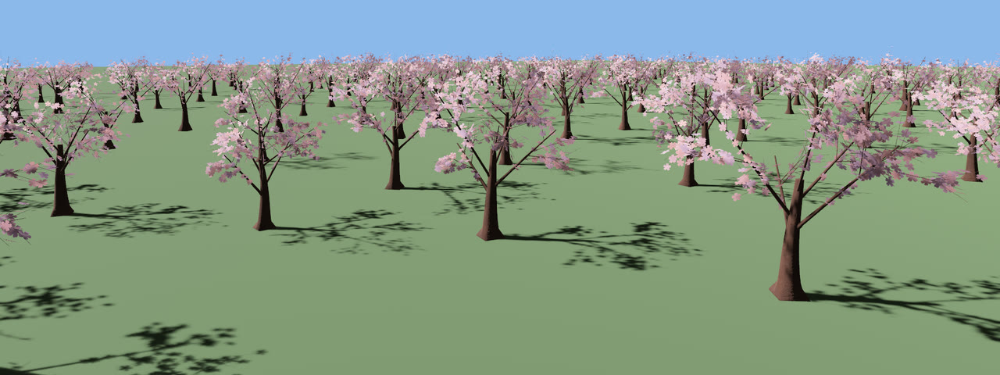
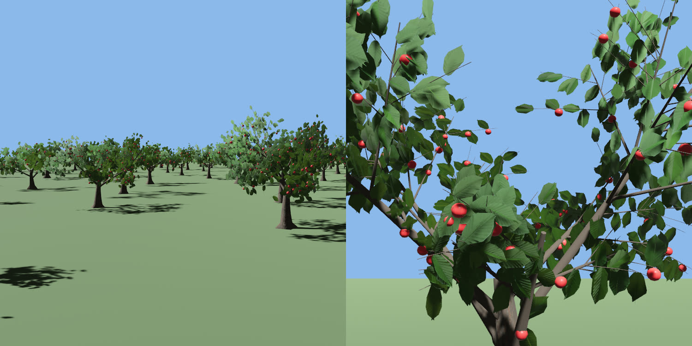
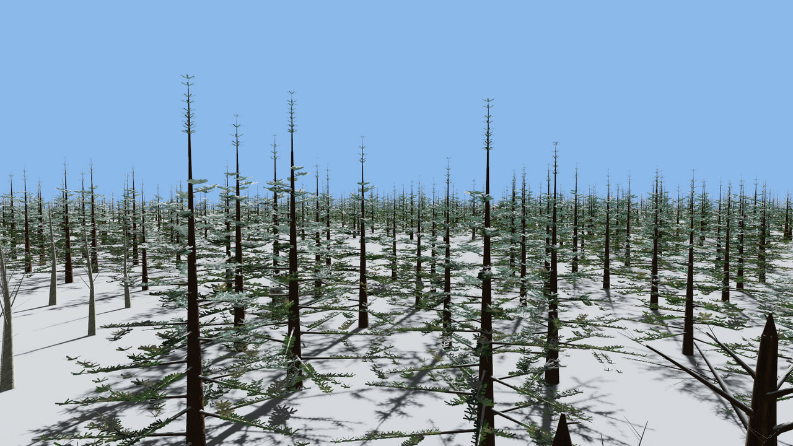
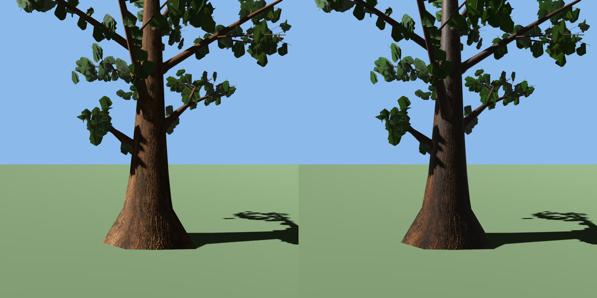

# Seasons and weather

A year passing over every tree, and rain soaking into them.

## Seasons

`FloraSeason` is a global resource like `FloraWind`: how far the leaves have turned (`autumn`, 0 summer green to 1 every leaf in its autumn colour), how many have fallen (`leaf_fall`, 0 to 1, bare), how much snow lies on the trees (`snow`, 0 to 1) and how far flowering trees are in blossom (`blossom`, 0 to 1). The deciduous presets (oak, willow, birch, bonsai, maple, poplar, baobab, Japanese maple and cherry) carry an autumn colour, `FoliageParams::autumn`; the evergreens have `None` and keep their needles. Leaves turn one at a time, each at its own moment, and fall in the order they turned. A fallen leaf is dropped in the vertex shader, so it leaves the shadows with it, and a leaf keeps its moment as the tree grows, on `GpuGrowth`, and on a pool's levels of detail; an impostor turns in patches of a few texels and thins its crown's coverage. Snow settles on every tree, first on what faces straight up and, as more falls, on steeper faces: the tops of branches, and on leaf and needle cards the side the camera sees when that side faces up (a tier of needles is white from above and green from below), as much as the leaf sees of the sky, with a light dusting on every exposed needle so a snowy conifer reads as snowy from below too. Impostors take it by their baked normals. The season shares the wind's buffer, so changing it every frame writes 96 bytes in place and touches no material: a year costs nothing per tree.

```rust,no_run
use bevy::prelude::*;
use bevy_flora::prelude::*;

// A year every two minutes: green until 0.55 of the way through, turning to 0.75, falling from
// 0.7 to 0.9, snowing from 0.88 to 0.92, melting from 0.98, the cherries in blossom from the
// year's turn to 0.07, and in leaf again by 0.07.
fn seasons(time: Res<Time>, mut season: ResMut<FloraSeason>) {
    *season = FloraSeason::of_year(time.elapsed_secs() / 120.0);
}

// Or set it outright: `FloraSeason::AUTUMN` is every leaf turned, `WINTER` bare trees, `SNOW`
// bare trees and every tree under snow, and `BLOSSOM` flowering trees in blossom on bare branches.
fn first_frost(mut season: ResMut<FloraSeason>) {
    *season = FloraSeason::AUTUMN;
}

// A preset's autumn colour, or one for a tree of your own; and flowers for any tree.
fn golden_oak() -> TreeParams {
    let mut params = TreePreset::Oak.params();
    params.foliage.autumn = Some(Color::srgb(0.85, 0.6, 0.1));
    params.foliage.blossom = Some(Color::srgb(0.98, 0.97, 0.92)); // white, like a pear's
    params
}
```

A flowering tree (`FoliageParams::blossom`, the cherry's pale pink) has a five-petalled flower at every leaf's stem, which opens as `blossom` rises, each at its own moment, and falls in the reverse order; `of_year` brings the cherry into blossom on bare branches as the snow goes and drops the flowers while the leaves come back. The flowers sway and rustle with the leaves, cast shadows, grow on `GpuGrowth` and thin out on a pool's coarser levels (with simpler petals there); an impostor paints them over its picture in patches. They are a mesh of their own (`TreeMeshes::flowers`), on a third child of the tree (`TreeRender::flower_entity`) that the plugin does not draw while `blossom` is 0, so out of season a flowering tree costs what it would without flowers. In blossom they are most of its vertices (the cherry: 18 400 leaf and 28 500 flower vertices at level 0, 4 900 and 3 400 at level 1, 1 900 and 1 300 at level 2): a thousand individual cherries take 22 ms a frame out of season and 41 ms in full blossom, where a thousand oaks take 24 ms (Apple M4 Pro). A pool keeps its flowers in its leaf meshes and the shaders hide them out of season, so a pooled tree drawn at its finest level still fetches them; but a pool draws most of its trees at the coarser levels and as impostors, and 100 000 pooled cherries take what 100 000 oaks do (7.6 and 7.5 ms).



*`cargo run --release --example forest -- --trees 700 --spacing 5 --scatter cherry:1 --clearing 7 --season 0,1,0,1 --wind 0.3 --sun -20,25,20 --eye 2,4.5,2 --at -25,1.5,-18 --fov 50 --deterministic --screenshot blossom.png`, cropped.*

A fruiting tree (`FoliageParams::fruit`: a `FruitParams` colour, radius and share of the leaves that bear one; the `Apple` preset's red apples on one leaf in eight) hangs a round fruit below the stem of some of its leaves. The fruit is in the leaf mesh: it sways with its leaf, stays round in the crown's shade (its underside is baked darker), grows with its leaf on a young tree and on `GpuGrowth`, and a pool's coarser levels carry fewer, larger fruit; an impostor, a few pixels across, leaves it out. The season brings it: no fruit while the blossom is out, then fruit all summer, dropping one by one in the first two thirds of the leaf fall, so `FloraSeason::of_year` gives an apple tree white blossom in spring, red apples through summer and bare branches by winter. A fruit is 63 vertices (35 on the coarser levels).



*`cargo run --release --example forest -- --mode pool --trees 400 --spacing 6.5 --scatter apple:1 --clearing 6 --wind 0.3 --sun -20,25,20 --eye 2,2.6,2 --at -20,1.8,-15 --fov 50 --deterministic --screenshot orchard.png`, cropped, and `cargo run --release --example inspect -- --out target/apple --preset apple --mode tree --distance 3.2 --yaw 300 --eye 1.6 --look 0.55 --fov 50`.*

A scattered winter forest under `FloraSeason::SNOW`: the spruces and pines keep their needles with snow on the tiers that face up, the oaks and birches stand bare with snow along their branches (the white ground is the example's, not the crate's):



*`cargo run --release --example forest -- --trees 3000 --spacing 7 --scatter spruce:3,pine:2,birch:2,oak:1 --grove 50 --clearing 25 --season 1,1,1 --eye 25,9,-75 --at 0,6,-20 --fov 50 --wind 0 --deterministic --screenshot snow.png`*

### Rain: `FloraWetness`

`FloraWetness` is how wet the trees are, 0 (dry, the default) to 1 (soaked), for the game's weather to raise while it rains and lower as the trees dry. Wet bark darkens to about half, its colour deepens and it turns glossy; a leaf keeps its brightness and only its green grows richer (a darker or glossier leaf lets the sky's white sheen grey the crown, which then reads as frost, not rain). It reaches every way a tree is drawn, pools and impostors included, snow lies over it, and changing it writes one value of the shared buffer, no material: dry, every tree is exactly as before.

```rust,no_run
use bevy::prelude::*;
use bevy_flora::prelude::*;

/// The game's weather.
#[derive(Resource)]
struct Raining(bool);

// A shower: soaked in a minute, dry again ten minutes after it stops.
fn rain(raining: Res<Raining>, time: Res<Time>, mut wetness: ResMut<FloraWetness>) {
    let rate = if raining.0 { 1.0 / 60.0 } else { -1.0 / 600.0 };
    wetness.0 = (wetness.0 + rate * time.delta_secs()).clamp(0.0, 1.0);
}
```



*`cargo run --release --example inspect -- --out target/wet --preset oak --mode tree --wet 1 --distance 6.5 --yaw 35 --eye 1.7 --look 0.3 --fov 55 --size 1200x1200` (and `--wet 0`), side by side.*
